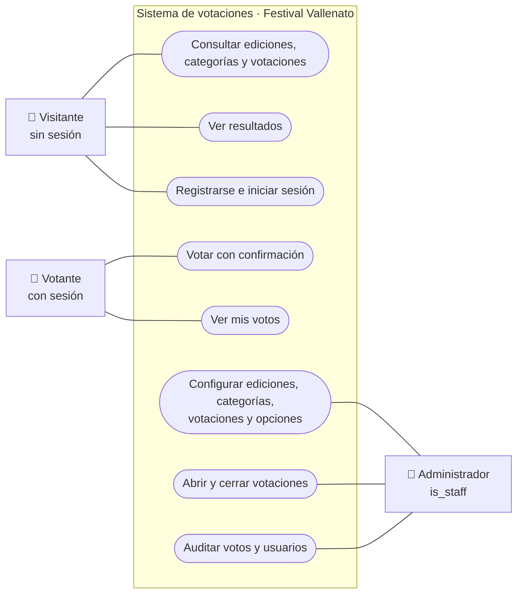
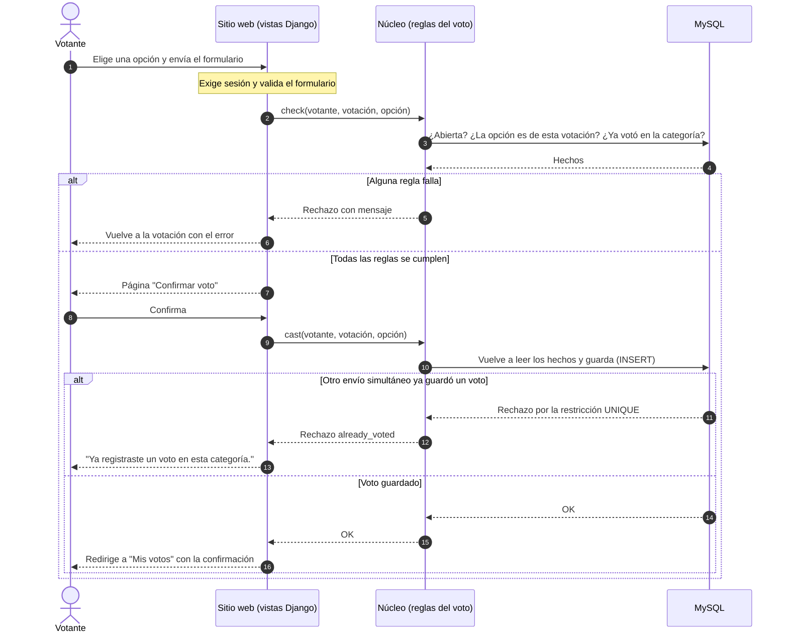
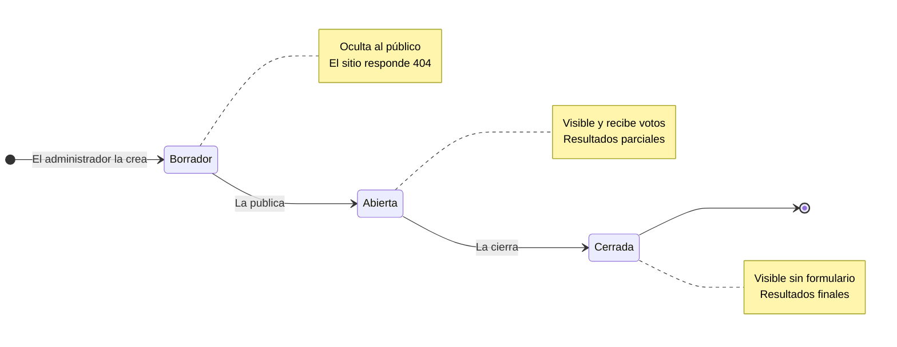

# Festival Vallenato 2027 · Sistema web de votaciones

Aplicación Django 5.2 + MySQL 8.4 para administrar las ediciones del Festival de la Leyenda
Vallenata y permitir que usuarios registrados voten **una sola vez por categoría y edición**.
El código sigue el patrón MVT de Django. Las reglas del voto viven en un núcleo hexagonal
(`catalog/core/`) que no depende de Django ni de MySQL.

> Artistas y canciones reales del vallenato; los votos son de demostración y no son resultados
> oficiales del festival. Proyecto académico local; no es un despliegue de producción.

## Contenido

1. [Arranque rápido](#1-arranque-rápido)
2. [Cómo funciona el sistema (diagramas)](#2-cómo-funciona-el-sistema-diagramas)
3. [Cómo leer el código en 10 minutos](#3-cómo-leer-el-código-en-10-minutos)
4. [Arquitectura: capas, puertos y adaptadores](#4-arquitectura-capas-puertos-y-adaptadores)
5. [Flujo de un voto](#5-flujo-de-un-voto)
6. [Front: Django Templates](#6-front-django-templates)
7. [Base de datos: modelo y conexión](#7-base-de-datos-modelo-y-conexión)
8. [Red: quién habla con quién](#8-red-quién-habla-con-quién)
9. [Usuarios, permisos y seguridad](#9-usuarios-permisos-y-seguridad)
10. [Validaciones](#10-validaciones)
11. [Admin de Django: base de datos y edición 2028](#11-admin-de-django-base-de-datos-y-edición-2028)
12. [Pruebas](#12-pruebas)
13. [Guion de sustentación (8 minutos)](#13-guion-de-sustentación-8-minutos)
14. [Banco de preguntas: respuestas y dónde mostrarlas](#14-banco-de-preguntas-respuestas-y-dónde-mostrarlas)
15. [Operación diaria](#15-operación-diaria)
16. [Estructura de carpetas](#16-estructura-de-carpetas)

---

## 1. Arranque rápido

Requisito: Docker Desktop encendido.

```bash
./start.sh
```

1. Si no existe `.env`, `start.sh` lo crea con secretos aleatorios (`scripts/create_env.py`).
2. Construye la imagen, levanta MySQL y Django, y **espera a que ambos estén sanos**.
3. Abre <http://localhost:8000/> (sitio público) y <http://localhost:8000/admin/> (admin de
   Django, ver [sección 11](#11-admin-de-django-base-de-datos-y-edición-2028)). El usuario
   administrador y su contraseña están en `.env` (`DEMO_ADMIN_USER` y `DEMO_ADMIN_PASSWORD`).
   Nunca compartas ese archivo.

Al iniciar, el contenedor web ejecuta en orden: `migrate` → `seed_demo` (datos de ejemplo 2027
y 2028) → `collectstatic` → `gunicorn` (ver `docker/entrypoint.sh`).

| Página | URL | Quién |
|---|---|---|
| Ediciones y catálogo | `/` | Cualquiera |
| Resultados | `/results/` | Cualquiera |
| Registro / login | `/accounts/register/` · `/accounts/login/` | Visitante |
| Mis votos | `/my-votes/` | Usuario con sesión |
| Administración | `/admin/` | Solo `is_staff` |
| API JSON | `/api/categorias/` | Cualquiera (solo GET) |
| Salud | `/health/` | Docker y diagnóstico |

---

## 2. Cómo funciona el sistema (diagramas)

Tres diagramas de alto nivel en Mermaid (GitHub y VS Code los dibujan solos): quién usa el
sistema, cómo viaja un voto y cómo cambia una votación. El detalle de capas y archivos está en la
[sección 4](#4-arquitectura-capas-puertos-y-adaptadores).

### Quién usa el sistema (casos de uso)



| Actor | Cómo llega a serlo | Qué puede hacer |
|---|---|---|
| Visitante | Entra al sitio sin iniciar sesión | Consultar el catálogo y los resultados, registrarse |
| Votante | Se registra e inicia sesión | Todo lo del visitante, más votar una vez por categoría y ver sus votos |
| Administrador | Usuario `is_staff` (lo crea `seed_demo`) | Todo lo anterior, más configurar el catálogo en `/admin/` y auditar votos |

### Cómo viaja un voto (secuencia)



El voto se valida dos veces: antes de mostrar la confirmación (`check`) y al guardarlo (`cast`),
porque la votación pudo cerrarse entre los dos pasos. La restricción `UNIQUE` de MySQL es la
última barrera cuando llegan dos envíos al mismo tiempo.

### Ciclo de vida de una votación (estados)



El administrador cambia el estado en `/admin/` → Votaciones. El sistema no bloquea otros cambios
(por ejemplo, reabrir una votación cerrada); el diagrama muestra el uso previsto.

---

## 3. Cómo leer el código en 10 minutos

Lee en este orden. Cada archivo es corto y tiene una sola responsabilidad.

| # | Archivo | Qué responde |
|---|---|---|
| 1 | `catalog/models.py` | ¿Qué se guarda en MySQL? |
| 2 | `catalog/core/domain.py` | ¿Cuáles son las reglas del voto y cómo se calculan los resultados? |
| 3 | `catalog/core/ports.py` | ¿Qué necesita el núcleo de la base de datos? (el contrato) |
| 4 | `catalog/core/services.py` | ¿Qué casos de uso existen? (validar, votar, ver resultados) |
| 5 | `catalog/repository.py` | ¿Cómo se cumple ese contrato con el ORM y MySQL? |
| 6 | `catalog/views.py` | ¿Cómo usa la web todo lo anterior? |
| 7 | `templates/catalog/poll_detail.html` → `vote_confirm.html` → `results.html` | ¿Qué ve el votante? |
| 8 | `config/settings.py` + `compose.yaml` | ¿Cómo se conecta a MySQL y a la red? |

---

## 4. Arquitectura: capas, puertos y adaptadores

### Diagrama

```text
              Navegador · curl · healthcheck de Docker
                                  │ HTTP «127.0.0.1:8000»
                                  ▼
┌──────────────── ADAPTADORES DE ENTRADA (Django) ─────────────────┐
│ catalog/views.py    páginas HTML + templates/                    │
│ catalog/api.py      JSON  GET /api/categorias/                   │
│ catalog/admin.py    administración dinámica  /admin/             │
│ accounts/views.py   registro · login · logout                    │
│ config/health.py    GET /health/  (SELECT 1)                     │
└─────────────────────────────────┬────────────────────────────────┘
                                  │ voting.check() · voting.cast() · voting.results()
                                  ▼
┌──────── NÚCLEO  catalog/core/  (Python puro, sin Django) ────────┐
│ services.py   VotingService      → casos de uso                  │
│ domain.py     check_vote · build_poll_result · VoteRejected      │
│ ports.py      VoteRepository     → PUERTO (el contrato)          │
└─────────────────────────────────┬────────────────────────────────┘
                                  │ implementa el puerto
                                  ▼
┌─────────── ADAPTADOR DE SALIDA  catalog/repository.py ───────────┐
│ DjangoVoteRepository  → traduce el contrato a consultas ORM      │
└─────────────────────────────────┬────────────────────────────────┘
                                  │ SQL «db:3306, red interna de Docker»
                                  ▼
                   MySQL 8.4 «volumen mysql_data»
```

**Regla de dependencias:** las flechas apuntan hacia adentro. Los adaptadores conocen al núcleo;
el núcleo no importa nada de Django (lo comprueba `catalog/test_core.py::ArchitectureTests`).

### Capas

| Capa | Archivo | Responsabilidad | ¿Usa Django? |
|---|---|---|---|
| Dominio | `catalog/core/domain.py` | Reglas del voto (`check_vote`), cálculo de resultados (`build_poll_result`), errores con mensaje (`VoteRejected`) | No |
| Puerto | `catalog/core/ports.py` | Contrato `VoteRepository`: `get_vote_facts`, `save_vote`, `list_results` | No |
| Casos de uso | `catalog/core/services.py` | `VotingService.check` (validar), `cast` (validar y guardar), `results` | No |
| Adaptador de salida | `catalog/repository.py` | `DjangoVoteRepository`: implementa el puerto con el ORM sobre MySQL | Sí |
| Adaptadores de entrada | `catalog/views.py`, `catalog/api.py`, `catalog/admin.py`, `accounts/views.py`, `config/health.py` | Reciben HTTP, llaman al núcleo o al ORM y responden | Sí |
| Modelo de datos | `catalog/models.py` | Tablas MySQL descritas como clases del ORM | Sí |
| Formularios | `catalog/forms.py`, `accounts/forms.py` | Validan lo que el usuario envía | Sí |
| Presentación | `templates/`, `static/css/site.css` | HTML y estilos (la "T" de MVT) | Sí |
| Configuración | `config/settings.py`, `config/urls.py` | Conexión, seguridad y rutas | Sí |
| Infraestructura | `compose.yaml`, `Dockerfile`, `docker/entrypoint.sh`, `start.sh` | Contenedores, red, arranque | — |

### Puertos y adaptadores

| Tipo | Nombre | Dónde | Qué hace |
|---|---|---|---|
| Puerto de salida | `VoteRepository` | `catalog/core/ports.py` | Lo que el núcleo pide a la persistencia |
| Adaptador de salida (real) | `DjangoVoteRepository` | `catalog/repository.py` | Cumple el puerto con MySQL |
| Adaptador de salida (pruebas) | `InMemoryVoteRepository` | `catalog/test_core.py` | Cumple el mismo puerto en memoria: prueba que el núcleo no necesita MySQL |
| Puerto de entrada | `VotingService` | `catalog/core/services.py` | Lo que la web puede pedirle al núcleo |
| Adaptador de entrada | `vote`, `results` | `catalog/views.py` | Traducen formularios HTTP a llamadas del servicio |

**Composition root (dónde se conecta todo):** una sola línea en `catalog/views.py`:

```python
voting = VotingService(DjangoVoteRepository())
```

### ¿Por qué hay páginas que usan el ORM directo?

Decisión de simplicidad: **todo lo que decide** (validar un voto, guardarlo, contar resultados)
pasa por el núcleo. Las páginas que **solo muestran** el catálogo (inicio, edición, categoría,
votación, mis votos), el admin y la API leen el ORM directamente, como en cualquier proyecto
Django MVT. Pasarlas por el núcleo agregaría código sin agregar reglas.

### Lecturas del diagrama

| Lectura | Resumen |
|---|---|
| Flujo de datos | Petición HTTP → adaptador de entrada → núcleo (reglas) → adaptador de salida → MySQL → respuesta HTML/JSON. Todo es síncrono: no hay colas ni trabajos en segundo plano. |
| Concurrencia | Gunicorn atiende con 2 procesos × 2 hilos. Dos votos simultáneos del mismo usuario los resuelve MySQL con la restricción única (ver [sección 5](#5-flujo-de-un-voto)). |
| Costo | Sin servicios externos de pago. Resultados = 2 consultas SQL (votaciones + conteo). API = 3 consultas sin importar cuántas categorías haya, sin N+1 (lo verifica `assertNumQueries(3)` en CP-10). |

---

## 5. Flujo de un voto

```text
① poll_detail.html ──POST opción──► ② views.vote ──voting.check()──► ③ check_vote(facts)
                                                                          │ reglas OK
④ vote_confirm.html ◄─────────────────────────────────────────────────────┘
   │ POST confirm=1
   ▼
⑤ views.vote ──voting.cast()──► check_vote(facts) ──► repository.save_vote() ──► INSERT en MySQL
                                                                 UNIQUE(user, category, edition)
⑥ redirige a "Mis votos" con mensaje   ·   regla rota → VoteRejected → mensaje de error
```

| Paso | Dónde | Qué pasa |
|---|---|---|
| ① | `templates/catalog/poll_detail.html` | El votante elige una opción (radio) y envía el formulario con ``. |
| ② | `catalog/views.py::vote` | `@login_required` exige sesión, `@require_POST` rechaza GET. `selected_option()` valida el formulario. |
| ③ | `VotingService.check` → `repository.get_vote_facts` → `domain.check_vote` | Lee 3 hechos de MySQL (¿abierta?, ¿la opción es de esta votación?, ¿ya votó en la categoría?) y aplica las reglas en ese orden. |
| ④ | `templates/catalog/vote_confirm.html` | Muestra "Vas a votar por X". Botón **Confirmar voto** reenvía con `confirm=1`. |
| ⑤ | `VotingService.cast` → `repository.save_vote` | Vuelve a validar (el estado pudo cambiar entre pasos) y hace el `INSERT` dentro de `transaction.atomic()`. |
| ⑥ | `catalog/views.py::vote` | Éxito: "Voto registrado: …" y redirección a `/my-votes/`. Error: mensaje y regreso a la votación. |

### Control de duplicados: dos niveles

| Nivel | Dónde | Cómo |
|---|---|---|
| 1. Regla de negocio | `catalog/core/domain.py::check_vote` | Si ya existe un voto del usuario en la categoría → `VoteRejected("already_voted")`. Se aplica en el paso ③ y otra vez en el ⑤. |
| 2. Base de datos | `catalog/models.py::Vote.Meta.constraints` | `UniqueConstraint(user, category, edition)` crea un índice único en MySQL. Si dos peticiones simultáneas pasan el nivel 1, MySQL acepta solo una; la otra lanza `IntegrityError`, que `repository.save_vote` traduce al mismo mensaje. |

La regla es **un voto por categoría y edición**, más estricta que "uno por votación": una
categoría puede tener varias votaciones (por ejemplo, Acordeonero favorito y Voz favorita en Íconos del vallenato) y
el usuario solo vota en una de ellas. Así también queda cubierto "no votar dos veces en la misma
votación".

### Votaciones no activas

`Poll.status` tiene tres estados: `draft` (Borrador), `open` (Abierta) y `closed` (Cerrada).

- **Borrador:** nunca sale del admin. Las vistas filtran por `Poll.PUBLIC_STATUSES` y un borrador
  responde 404.
- **Cerrada:** se puede consultar y aparece en resultados como "Final", pero no muestra el
  formulario. Si alguien fuerza el POST, `check_vote` lo rechaza con `poll_not_open`.

### Resultados: de dónde salen

`/results/` → `views.results` → `VotingService.results()` → `DjangoVoteRepository.list_results()`:

1. Una consulta trae las votaciones abiertas y cerradas con su categoría y edición (`JOIN`).
2. Otra cuenta los votos por opción (`COUNT(vote.id) … GROUP BY option`) sobre la tabla `catalog_vote`.
3. `domain.build_poll_result` suma el total, calcula porcentajes redondeados y ordena por votos.

No hay contadores guardados ni caché: cada visita cuenta los votos reales de MySQL. Las
votaciones abiertas se marcan como "Parcial" y las cerradas como "Final".

---

## 6. Front: Django Templates

El front son **plantillas de Django** con CSS propio, sin JavaScript ni frameworks de front.
Es la "T" de MVT que pide la asignatura y mantiene todo en un solo proyecto. React o Vue
obligarían a crear una segunda aplicación, un proceso de build y una API para cada pantalla.

| Pieza | Dónde | Para qué |
|---|---|---|
| Plantilla base | `templates/base.html` | Encabezado, menú, mensajes y pie. Las páginas solo llenan ``. |
| Herencia | `` | Primera línea de cada página. |
| Include | `templates/includes/form_fields.html` | Pinta cualquier formulario de Django (login y registro) sin repetir HTML. |
| Rutas | `` | Enlaces por nombre de ruta, no por texto fijo. |
| Seguridad | `` | Va en todo formulario POST. |
| Estilos | `static/css/site.css` | Servido por WhiteNoise. |

Cada plantilla empieza con un comentario que dice qué vista la pinta, por ejemplo
`{# Rendered by catalog.views.poll_detail #}`. Así se puede saltar de la pantalla al código.

---

## 7. Base de datos: modelo y conexión

### Modelo de datos (`catalog/models.py`)

```text
Edition (year único)
  └─1:N─ Category (nombre único por edición)
           └─1:N─ Poll (status: draft | open | closed)
                    └─1:N─ Option (nombre único por votación)

User (django.contrib.auth) ─1:N─ Vote ─N:1─ Option
Vote también guarda poll, category y edition
UNIQUE (user, category, edition)  → un voto por categoría y edición
```

`Vote` repite `category` y `edition` (además de `option`) porque una restricción única de MySQL
solo puede usar columnas de su propia tabla. Las llaves foráneas de `Vote` usan `PROTECT`: no se
puede borrar una opción, votación, categoría o edición que ya tenga votos.

### ¿Dónde se configura y se valida la conexión a MySQL?

| # | Dónde | Qué valida |
|---|---|---|
| 1 | `config/settings.py` → `DATABASES` | Motor `django.db.backends.mysql`, host `db`, puerto `3306`, `utf8mb4` y `STRICT_TRANS_TABLES`. `required_environment("MYSQL_PASSWORD")` detiene el arranque con `ImproperlyConfigured` si falta la contraseña. |
| 2 | `compose.yaml` → `db.healthcheck` | Cada 5 s ejecuta `mysql … -e 'SELECT 1'`. MySQL queda "healthy" solo cuando responde. |
| 3 | `compose.yaml` → `web.depends_on: condition: service_healthy` | Django no arranca hasta que MySQL esté sano. |
| 4 | `docker/entrypoint.sh` → `migrate` | Primera orden al iniciar. Si no hay conexión, falla y el contenedor se detiene (`set -eu`). |
| 5 | `config/health.py` → `GET /health/` | Ejecuta `SELECT 1` en cada llamada: `200 {"status": "ok", "database": "ok"}` o `503 {"status": "error", "database": "unavailable"}`. Lo usa el healthcheck de `web` y `start.sh` espera por él (`--wait`). |

Otros detalles:

- **Migraciones:** `catalog/migrations/` versiona el esquema; `migrate` corre en cada arranque.
- **Persistencia:** los datos viven en el volumen Docker `mysql_data` y sobreviven a reinicios.
- **Base de pruebas:** `docker/mysql-init/01-test-grant.sql` da permiso sobre `test_festival`,
  la base temporal que crea `manage.py test`.

---

## 8. Red: quién habla con quién

```text
Navegador en tu computador
    │ http://127.0.0.1:8000  «publicado solo en loopback»
    ▼
┌──────────── contenedor web ────────────┐           ┌──────────── contenedor db ─────────────┐
│ gunicorn escucha 0.0.0.0:8000          │           │ MySQL 8.4 escucha 3306                 │
│ Django · config/settings.py            │ ──TCP───► │ nombre en la red: db                   │
│ healthcheck: GET /health/              │  db:3306  │ healthcheck: SELECT 1                  │
└────────────────────────────────────────┘           │ sin puerto publicado al host           │
                                                     └────────────────────────────────────────┘
           (ambos contenedores comparten la red interna que crea Docker Compose)
```

| Tramo | Valor | Dónde se define |
|---|---|---|
| Navegador → web | `127.0.0.1:8000` (solo esta máquina) | `compose.yaml` → `ports: "127.0.0.1:${WEB_PORT:-8000}:8000"` |
| Gunicorn dentro del contenedor | `0.0.0.0:8000` | `Dockerfile` → `CMD` |
| web → MySQL | `db:3306` por DNS interno de Compose | `compose.yaml` → `MYSQL_HOST: db`, `MYSQL_PORT: "3306"` |
| MySQL hacia el host | No publicado: nadie fuera de Docker lo alcanza | `compose.yaml` (el servicio `db` no tiene `ports`) |
| Hosts permitidos | `localhost,127.0.0.1` | `DJANGO_ALLOWED_HOSTS` → `settings.ALLOWED_HOSTS` |
| Chequeo de red de la app | `http://127.0.0.1:8000/health/` desde el contenedor | `compose.yaml` → `web.healthcheck` |

---

## 9. Usuarios, permisos y seguridad

| Tema | Cómo funciona | Dónde |
|---|---|---|
| Registro | `RegistrationForm` (basado en `UserCreationForm`) crea un usuario votante (`is_staff=False`). | `accounts/forms.py`, `accounts/views.py::RegistrationView` |
| Login / logout | Vistas estándar de Django. Logout solo por POST. | `accounts/views.py` |
| Administrador | `seed_demo` crea un usuario `is_staff` con datos de `.env`. | `catalog/management/commands/seed_demo.py` |
| Votante vs admin | Votar y "Mis votos" exigen sesión (`@login_required`). `/admin/` exige `is_staff`. El enlace "Administración" solo aparece al staff. | `catalog/views.py`, `templates/base.html` |
| Votos de solo lectura | En el admin nadie puede crear, editar ni borrar votos. | `catalog/admin.py::VoteAdmin` |
| Contraseñas | Django guarda un hash PBKDF2-SHA256 con sal, nunca texto plano. Cuatro validadores: similitud con el usuario, largo mínimo, contraseñas comunes, solo números. | `config/settings.py` → `AUTH_PASSWORD_VALIDATORS` |
| CSRF | Todo POST lleva token; sin token → 403. | `CsrfViewMiddleware` + `` |
| Redirección segura | El parámetro `next` solo acepta URLs del mismo sitio. | `accounts/views.py` (`url_has_allowed_host_and_scheme`) |
| Cookies y marcos | Cookies `HttpOnly`; `X_FRAME_OPTIONS = "DENY"`. | `config/settings.py` |
| Secretos | `.env` generado con `secrets.token_hex`, permisos `600`, fuera de git. | `start.sh`, `scripts/create_env.py`, `.gitignore` |
| Contenedores | Web corre con usuario sin privilegios (`USER app`), `cap_drop: ALL`, `no-new-privileges`. | `Dockerfile`, `compose.yaml` |

**¿Qué pasa sin permiso?**

| Intento | Respuesta |
|---|---|
| Votar o abrir "Mis votos" sin sesión | Redirige a `/accounts/login/?next=…` |
| Votante entra a `/admin/` | Pantalla de login del admin; no ve nada |
| GET a `/polls/<id>/vote/` | 405 Method Not Allowed |
| POST sin token CSRF | 403 Forbidden |
| Votación en borrador o inexistente | 404 con página propia |

---

## 10. Validaciones

| Situación | Dónde se valida | Qué ve el usuario |
|---|---|---|
| Usuario repetido, contraseñas distintas o débiles | `UserCreationForm` + `AUTH_PASSWORD_VALIDATORS` | Errores junto al campo |
| Login incorrecto | `AuthenticationForm` de Django | Mensaje de error |
| Enviar sin elegir opción | `views.selected_option` → `option_required` | "Selecciona una opción antes de continuar." |
| Opción de otra votación | `VoteForm` + `check_vote` → `option_mismatch` | "La opción no pertenece a esta votación." |
| Votación no abierta | `check_vote` → `poll_not_open` | "La votación no está habilitada para recibir votos." |
| Segundo voto en la categoría | `check_vote` + `UniqueConstraint` → `already_voted` | "Ya registraste un voto en esta categoría." |
| Año de edición, categoría u opción repetidos | `unique=True` y `UniqueConstraint` en `catalog/models.py` | Error en el formulario del admin |
| Cambiar la categoría o votación de algo que ya tiene votos | `LockParentOnceVotedMixin` en `catalog/admin.py` | El campo queda de solo lectura |

Todos los mensajes del voto están en un solo lugar: `VoteRejected.MESSAGES` en
`catalog/core/domain.py`.

---

## 11. Admin de Django: base de datos y edición 2028

El admin de Django es la pantalla web para ver y editar los datos de MySQL sin escribir SQL ni
código. Lo genera Django a partir de `catalog/admin.py`.

### Cómo entrar

1. Inicia el proyecto con `./start.sh`.
2. Abre <http://localhost:8000/admin/>.
3. Usuario y contraseña: `DEMO_ADMIN_USER` y `DEMO_ADMIN_PASSWORD` del archivo `.env`
   (`grep DEMO_ADMIN .env` los muestra en tu terminal). `seed_demo` crea ese usuario como
   `is_staff` e `is_superuser` en cada arranque.
4. En el sitio público, el enlace **Administración** del menú aparece solo para usuarios staff.

¿Otro administrador? `docker compose exec web python manage.py createsuperuser`.

| Sección del admin | Tabla MySQL | Qué se hace |
|---|---|---|
| Catálogo → Ediciones | `catalog_edition` | Crear el año y sus categorías en la misma pantalla |
| Catálogo → Categorías | `catalog_category` | Editar categorías y agregar sus votaciones |
| Catálogo → Votaciones | `catalog_poll` | Agregar opciones y cambiar el estado: Borrador, Abierta o Cerrada |
| Catálogo → Opciones | `catalog_option` | Editar participantes |
| Catálogo → Votos | `catalog_vote` | **Solo lectura:** ver quién votó, cuándo y por qué opción |
| Autenticación y autorización → Usuarios / Grupos | `auth_user`, `auth_group` | Ver votantes y dar o quitar `is_staff`. La contraseña solo aparece como hash |

### Ver las tablas directamente en MySQL

MySQL no tiene puerto abierto hacia tu computador ([sección 8](#8-red-quién-habla-con-quién)),
así que se entra desde dentro del contenedor `db`:

```bash
docker compose exec db sh -c 'MYSQL_PWD="$MYSQL_PASSWORD" mysql --default-character-set=utf8mb4 -u festival festival'
```

La contraseña se toma de la variable del contenedor; no se escribe ni se muestra. Ejemplos dentro
de la consola (salir con `exit`):

```sql
SHOW TABLES;
SELECT * FROM catalog_vote;
SELECT o.name, COUNT(v.id) AS votos
FROM catalog_option o LEFT JOIN catalog_vote v ON v.option_id = o.id
GROUP BY o.id ORDER BY votos DESC;
```

### Crear el Festival 2028 sin código

Todo el catálogo se configura desde `/admin/`, **sin tocar código ni crear migraciones**: una
edición nueva son filas nuevas, no tablas nuevas.

Pasos para el Festival 2028:

1. **Ediciones → Agregar:** año `2028` y nombre. En la misma pantalla se agregan las categorías.
2. **Categorías:** en cada una se agregan sus votaciones en estado **Borrador**.
3. **Votaciones:** en cada una se agregan las opciones o participantes.
4. Cuando todo esté listo, cambiar la votación a **Abierta**: aparece en el sitio público.
5. Al terminar, cambiar a **Cerrada**: deja de recibir votos y `/results/` la muestra como final.

`seed_demo` ya trae una edición 2028 de ejemplo para mostrarlo. Una vez que hay votos, el admin
bloquea cambiar el padre de una categoría, votación u opción, para no alterar resultados.

---

## 12. Pruebas

61 pruebas automatizadas. Se ejecutan contra MySQL real, salvo las del núcleo, que no tocan la
base de datos.

```bash
docker compose exec -T web python manage.py test accounts catalog --noinput   # todas
docker compose exec -T web python manage.py test catalog.test_core            # solo el núcleo
docker compose exec -T web python manage.py check                             # configuración
docker compose exec -T web python manage.py makemigrations --check --dry-run  # modelos = migraciones
```

| Archivo | Pruebas | Qué cubre |
|---|---|---|
| `catalog/test_core.py` | 12 | Reglas y su orden, porcentajes y empates, servicio con repositorio en memoria, núcleo sin imports de Django |
| `catalog/test_voting.py` | 24 | Casos CP-01 a CP-11: flujo de voto, duplicados, admin, concurrencia, API y resultados |
| `catalog/tests.py` | 14 | Relaciones y unicidad del catálogo, páginas públicas, borradores ocultos, datos de ejemplo reales |
| `accounts/tests.py` | 11 | Registro, hash de contraseña, `next` seguro, logout POST, CSRF, admin, `/health/` |

| Caso | Qué demuestra |
|---|---|
| CP-01 | Voto válido: pide confirmación y luego guarda edición, categoría, votación y opción |
| CP-02 | Segundo voto en la misma categoría rechazado (otra opción u otra votación de la categoría) |
| CP-03 | Votar en otra categoría sí se permite |
| CP-04 | Sin sesión → login y no se guarda nada |
| CP-05 | Votación cerrada rechaza; borrador responde 404 |
| CP-06 | Opción de otra categoría rechazada |
| CP-07 | "Mis votos" muestra solo los votos propios |
| CP-08 | Lista de votos del admin coincide con MySQL y es de solo lectura |
| CP-09 | Dos peticiones simultáneas guardan un solo voto |
| CP-10 | La API devuelve JSON válido con datos de MySQL |
| CP-11 | Resultados cuentan los votos guardados (2/1/0 → 67 %/33 %/0 %) y ocultan borradores |

Además se sembraron fallos a mano en el núcleo, el repositorio y la vista (quitar la regla de
duplicado, cambiar el redondeo, saltar la confirmación, etc.). Las pruebas detectaron los 8.

---

## 13. Guion de sustentación (8 minutos)

Antes del turno: `./start.sh`, navegador en <http://localhost:8000/> y admin abierto en otra
pestaña. Los datos de ejemplo ya existen.

| Tiempo | Qué mostrar | Dónde |
|---|---|---|
| 0:00–1:00 | Presentación: qué hace el sistema, Django + MySQL, casos de uso (sección 2) y arquitectura (sección 4) | Este README |
| 1:00–1:50 | **Admin dinámico:** abrir la edición 2028, agregar una opción, cambiar una votación a Abierta | `/admin/` |
| 1:50–2:30 | **Usuarios:** registrar un votante nuevo; el menú no muestra "Administración" | `/accounts/register/` |
| 2:30–3:30 | **Votar:** Ediciones → 2027 → Íconos del vallenato → Voz favorita → Diomedes Díaz → Confirmar → "Mis votos" | Sitio público |
| 3:30–4:00 | **Duplicado:** intentar votar en Acordeonero favorito (misma categoría) → "Ya registraste un voto…" | Sitio público |
| 4:00–4:30 | **Resultados:** el conteo subió; en el admin, Votos muestra el registro de solo lectura | `/results/`, `/admin/` |
| 4:30–5:00 | **Validaciones:** Homenaje a Rafael Escalona (cerrada) sin formulario; cerrar sesión y abrir `/my-votes/` → login | Sitio público |
| 5:00–7:00 | Preguntas del docente (sección 14) | Código |
| 7:00–8:00 | Cierre: 61 pruebas en verde, núcleo hexagonal. Mejoras: HTTPS y despliegue, cierre automático por fecha, exportar resultados, límite de intentos de login | — |

---

## 14. Banco de preguntas: respuestas y dónde mostrarlas

### A. Django y estructura del proyecto

| Pregunta | Respuesta corta | Mostrar |
|---|---|---|
| ¿Por qué Django? | Trae ORM, admin automático (administración dinámica sin código), autenticación con hash, CSRF, migraciones y plantillas. Python es legible y el MVT es el patrón pedido. | `config/settings.py` → `INSTALLED_APPS` |
| ¿Qué hacen modelos, vistas y plantillas? | Modelos = tablas MySQL. Vistas = reciben la petición, deciden y responden. Plantillas = HTML. Las reglas del voto están aparte, en el núcleo. | `catalog/models.py`, `catalog/views.py`, `templates/` |
| ¿Dónde están los modelos? | `catalog/models.py`: `Edition`, `Category`, `Poll`, `Option`, `Vote`. Los usuarios son el `User` de Django. | `catalog/models.py` |
| ¿Cómo se conecta una URL con una vista? | `config/urls.py` incluye `catalog/urls.py`; ahí `path("polls/<int:pk>/", views.poll_detail, name="poll")`. Las plantillas usan ``. | `config/urls.py`, `catalog/urls.py` |

### B. MySQL y administración dinámica

| Pregunta | Respuesta corta | Mostrar |
|---|---|---|
| ¿Dónde se configura la conexión? | `DATABASES` en `config/settings.py`, con valores de `.env` que pasa `compose.yaml`. Ver [sección 7](#7-base-de-datos-modelo-y-conexión). | `config/settings.py`, `/health/` |
| ¿Relación edición–categoría–votación–opción? | Cadena 1:N: una edición tiene categorías, una categoría tiene votaciones, una votación tiene opciones. El voto une usuario y opción. | `catalog/models.py`, diagrama de la sección 7 |
| ¿Qué son las migraciones? | Archivos que versionan el esquema y crean o alteran tablas. `migrate` corre en cada arranque; `makemigrations --check` confirma que no falta ninguna. | `catalog/migrations/`, `docker/entrypoint.sh` |
| ¿Cómo se crea una edición nueva sin código? | Desde el admin: edición → categorías → votaciones → opciones → Abierta. Ver [sección 11](#11-admin-de-django-base-de-datos-y-edición-2028). | `/admin/` |

### C. Usuarios y seguridad

| Pregunta | Respuesta corta | Mostrar |
|---|---|---|
| ¿Cómo se registra e inicia sesión? | `/accounts/register/` crea un votante con contraseña validada; `/accounts/login/` usa el login de Django; logout por POST. | `accounts/views.py` |
| ¿Permisos admin vs votante? | El admin tiene `is_staff` y entra a `/admin/`. El votante solo vota y ve sus votos. Nadie edita votos. | `catalog/admin.py::VoteAdmin`, `templates/base.html` |
| ¿Cómo se protegen las contraseñas? | Hash PBKDF2-SHA256 con sal y validadores de fortaleza. En la tabla `auth_user` solo hay hash. | `accounts/tests.py` (prueba de hash), admin → Usuarios |
| ¿Qué pasa sin permiso? | Login con `next`, login del admin, 405, 403 o 404 según el caso. Ver [sección 9](#9-usuarios-permisos-y-seguridad). | Cerrar sesión y abrir `/my-votes/` |

### D. Proceso de votación y resultados

| Pregunta | Respuesta corta | Mostrar |
|---|---|---|
| ¿Qué pasa desde que elige hasta que se guarda? | Pasos ①–⑥ de la [sección 5](#5-flujo-de-un-voto): validar formulario → reglas → confirmar → reglas otra vez → `INSERT` con restricción única. | `catalog/views.py::vote`, `catalog/core/` |
| ¿Cómo evita votar dos veces? | Regla `already_voted` en el núcleo + `UniqueConstraint(user, category, edition)` en MySQL. | `catalog/core/domain.py`, `catalog/models.py` |
| ¿Cómo impide votar en una votación no activa? | Borradores = 404; cerradas = sin formulario y regla `poll_not_open`. | `Poll.PUBLIC_STATUSES`, `check_vote` |
| ¿De dónde salen los resultados? | De contar las filas de `catalog_vote` en cada visita (`COUNT … GROUP BY`). Nada se guarda aparte. | `catalog/repository.py::list_results` |

### E. Pruebas y continuidad

| Pregunta | Respuesta corta | Mostrar |
|---|---|---|
| ¿Qué pruebas realizaron? | 61 pruebas automáticas (sección 12), fallos sembrados a mano y healthchecks de Docker. | `docker compose exec -T web python manage.py test accounts catalog --noinput` |
| ¿Qué dificultad encontraron? | (1) Django arrancaba antes que MySQL → healthcheck + `service_healthy`. (2) Dos clics simultáneos podían duplicar el voto → restricción única en MySQL + traducción de `IntegrityError`. (3) Las pruebas necesitaban permiso sobre `test_festival` → script de `docker/mysql-init`. (4) Con `DEBUG=False` Django exige el manifest de estáticos y sin él las páginas daban error 500 → `collectstatic` en `docker/entrypoint.sh` y WhiteNoise sirve el CSS. | `compose.yaml`, `catalog/repository.py`, `docker/` |
| ¿Qué hace el admin para 2028? | Crear la edición y su catálogo en `/admin/` y abrir las votaciones. No se toca código. | [Sección 11](#11-admin-de-django-base-de-datos-y-edición-2028) |

---

## 15. Operación diaria

```bash
docker compose ps                     # estado de db y web (healthy)
docker compose logs -f web            # registros de Django/gunicorn
docker compose down                   # detener (los datos se conservan)
./start.sh                            # volver a iniciar
curl -s http://127.0.0.1:8000/health/ # {"status": "ok", "database": "ok"}
curl -s http://127.0.0.1:8000/api/categorias/
```

> **No uses `docker compose down -v`:** borra el volumen `mysql_data` y con él todos los votos.

**Límites de seguridad:** solo escucha en `127.0.0.1`, MySQL no está publicado, `DEBUG=False` por
defecto y sin HTTPS. Es un entorno académico local, no un despliegue de producción.

---

## 16. Estructura de carpetas

```text
festival-vallenato-2027/
├── accounts/               registro, login y logout (forms, views, urls, tests)
├── catalog/
│   ├── core/               NÚCLEO hexagonal (Python puro)
│   │   ├── domain.py       reglas del voto y cálculo de resultados
│   │   ├── ports.py        puerto VoteRepository
│   │   └── services.py     casos de uso VotingService
│   ├── repository.py       adaptador de salida (ORM → MySQL)
│   ├── views.py            adaptador web (páginas, voto, resultados)
│   ├── api.py              adaptador JSON
│   ├── admin.py            administración dinámica
│   ├── forms.py            formulario de voto
│   ├── models.py           tablas
│   ├── migrations/         esquema versionado
│   ├── management/commands/seed_demo.py   datos de ejemplo (artistas y canciones reales)
│   └── test_core.py · test_voting.py · tests.py
├── config/                 settings, urls, health.py, wsgi/asgi
├── templates/              plantillas Django (base, catalog, accounts, errores)
├── static/css/site.css     estilos
├── docker/                 entrypoint.sh y permiso de la base de pruebas
├── scripts/create_env.py   genera .env con secretos aleatorios
├── compose.yaml · Dockerfile · start.sh · requirements.txt
└── .env.example            variables necesarias (sin valores reales)
```

Repositorio público: [wesvh/web-dev-areandina-2027](https://github.com/wesvh/web-dev-areandina-2027).

```bash
git clone https://github.com/wesvh/web-dev-areandina-2027.git
cd web-dev-areandina-2027 && ./start.sh
```
